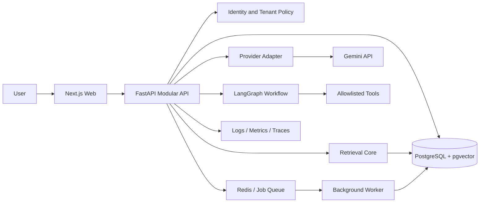

# System Design

## Current deployment shape

A modular monolith is the initial application boundary. The API owns authentication, tenant authorization, documents, retrieval, conversations, agent runs, analytics and audit APIs. A separately executable worker will own long-running ingestion/evaluation jobs. PostgreSQL is the system of record and pgvector stores embeddings. Redis is reserved for queue coordination, bounded caching and rate limits where justified. The Next.js application is a presentation client; it never owns authorization decisions or provider secrets.

## Logical data flow

## Trust boundaries

1. Browser to API: authenticate, validate input, rate limit.
2. API to database: scoped queries and explicit transactions.
3. Uploaded documents to parser: treat bytes and extracted text as untrusted.
4. Retrieved chunks to model: evidence only, never privileged instructions.
5. Model to tool registry: validate schema, user permissions, tenant scope and approval before execution.
6. API to provider: server-side secret, bounded timeout and usage accounting.

## Current implementation boundary

Only the identity foundation, basic tenant membership read check, health endpoints and static workspace shell have been authored. The remaining logical components are planned and must not be represented as operational.
